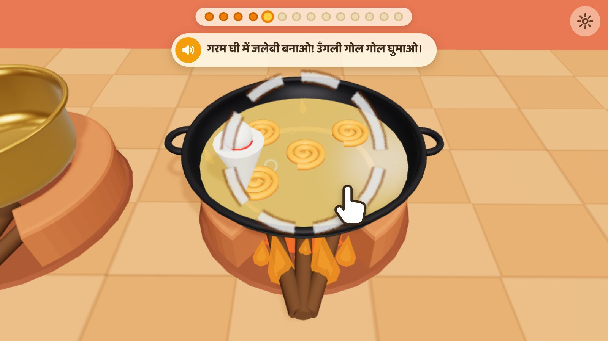
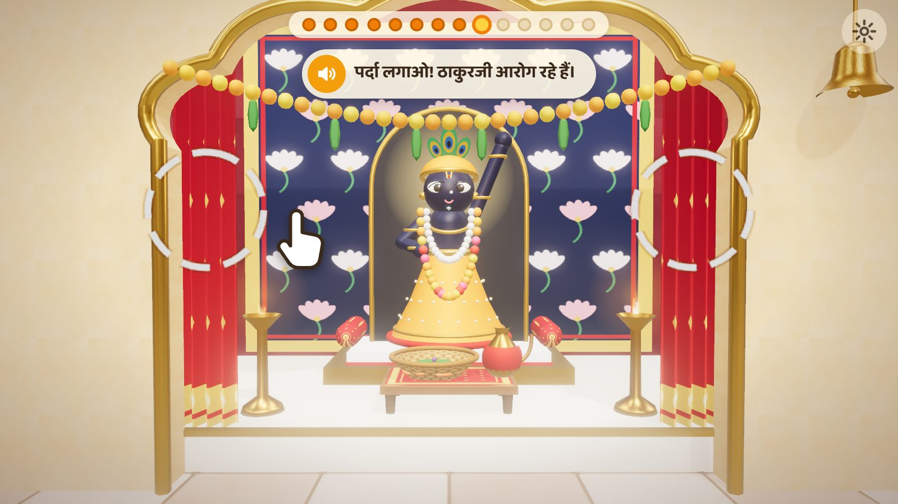
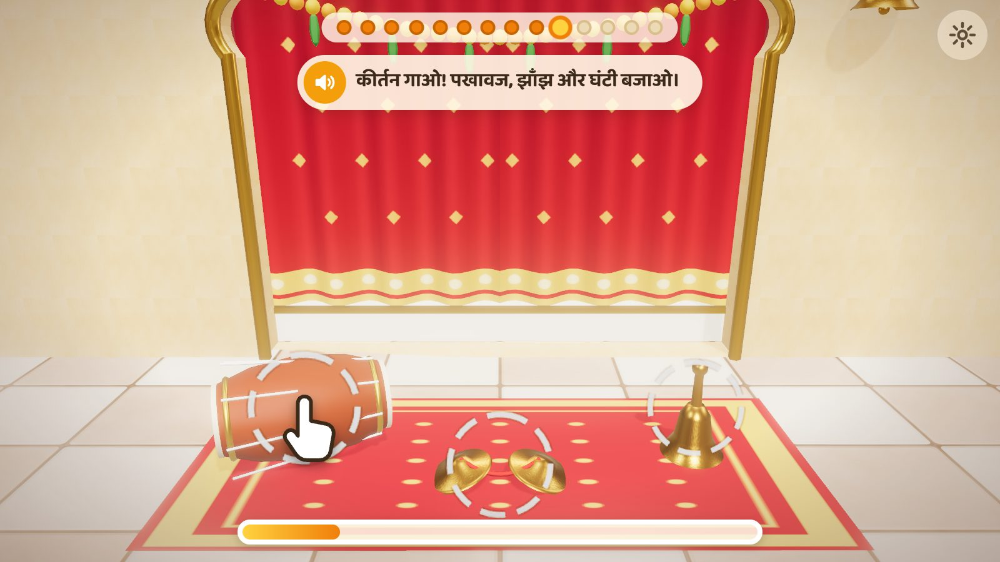
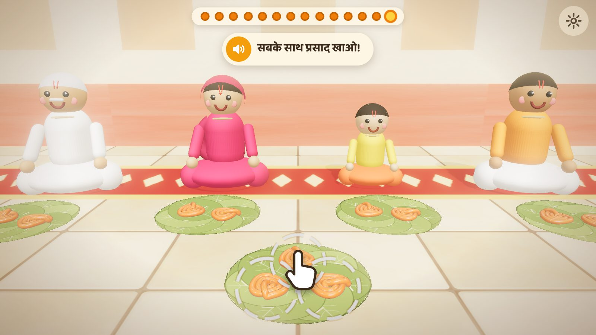

# जलेबी सेवा · Jalebi Seva

A 3D game for a toddler, seen through the eyes of a halwai: make jalebi from
scratch, offer it as bhog to Shreenathji, and share the prasad with the
Vaishnavs.

| | |
|---|---|
|  |  |
|  |  |

## The game

Fourteen little steps, each one a tap, a stir or a swipe:

| | Step | What the child does |
|---|---|---|
| 1 | घोल बनाओ | Tip maida, dahi and water into the bowl, then stir |
| 2 | चाशनी बनाओ | Sugar and water into the pateela, light the chulha, stir |
| 3 | केसर डालो | Three pinches of kesar – the syrup turns golden |
| 4 | इलायची डालो | Pop the pods in |
| 5 | जलेबी बनाओ | Touch the hot ghee: every touch pipes a perfect jalebi, as many as the child likes. Touch the chaasni to move on |
| 6 | चाशनी में डुबाओ | Send the jalebis into the syrup (when the kadhai is full, the oldest hop in by themselves) |
| 7 | टोकरी में रखो | Scoop every jalebi from the chaasni into the tokri |
| 8 | भोग धरो | Place the tokri before Shreenathji, the tulsi on top, then the jhari |
| 9 | पर्दा लगाओ | Draw the curtains closed |
| 10 | कीर्तन गाओ | Play the pakhawaj, jhanjh and ghanti along with the music |
| 11 | पर्दा खोलो | Open the curtains – darshan, shankh, flowers |
| 12 | भोग सराओ | Take the tokri back; it is prasad now |
| 13 | पातल परोसो | Lay a paatal for each Vaishnav and serve the jalebi |
| 14 | सबके साथ खाओ | Eat together – जय श्री कृष्ण! |

Every jalebi the child makes goes into the one tokri that is offered: make three or thirty, they are all there.

### Made for very small hands

- **Nothing can go wrong.** No timer, no score, no "try again". Every touch
  does something.
- **Things answer on touch-down**, with a generous target, so pressing,
  holding, smearing and slapping all work. A resting palm does not block the
  playing finger.
- **The next thing to touch is always ringed**, and a hand comes to show it
  after a couple of seconds of waiting.
- **Every step is spoken aloud** in Hindi, Gujarati or English.
- **No ads, no links, no purchases, no internet use.** The Android app serves
  everything from inside itself and refuses every other address.

## Install on an Android phone or tablet

1. Copy `release/jalebi-seva-0.2.0.apk` to the phone and open it.
2. Android will ask to allow installing from this source – allow it, then
   install. (Play Protect may ask to scan an app it has not seen; that is fine.)
3. Open **Jalebi Seva**. It plays in landscape, full screen.

Needs Android 7 or newer.

**For the voice:** the app uses the phone's own text-to-speech. If nothing is
spoken, open *Settings → Accessibility → Text-to-speech output* (wording
varies by phone), choose the Google engine and install the **Hindi** (or
**Gujarati**) voice. Without it the game still plays, silently guided by the
hand.

**To keep a toddler inside the game:** turn on Android's *App pinning*
(*Settings → Security*), open the game and pin it. The back button also has to
be pressed three times quickly before the game closes.

### Parents' corner

Hold the small gear (top right) for a second: change language, turn sound or
speech off, skip a step, or start over.

## Make it your own

- **Your own 3D models (Tripo AI).** Every object is a slot that a `.glb`
  can replace – above all Shreenathji's swaroop. Start with the easy guide,
  [docs/TRIPO_EASY_HINDI.md](docs/TRIPO_EASY_HINDI.md); the full list is in
  [docs/TRIPO_ASSETS.md](docs/TRIPO_ASSETS.md), and reference images and
  sources in [docs/REFERENCE_PACK.md](docs/REFERENCE_PACK.md).
- **Your own kirtan.** Save a recording as `public/audio/kirtan.mp3` and it
  plays during the kirtan and darshan steps instead of the built-in tune.
- **Your own pichwai.** A photo in `public/models/`, named under `textures`
  in `public/models/manifest.json`.
- **The words.** All prompts are in `src/game/i18n.js`.
- **The steps themselves.** `src/game/steps.js`, one function per step.

After any change, rebuild the APK (below).

## Build it yourself

Needs Node 20+, and for the APK a JDK 17+ and the Android SDK (platform 35,
build-tools 35).

```bash
npm install
npm run dev            # play in a browser at http://localhost:5173
npm run build:android  # web build -> android/app/src/main/assets/www
cd android
./gradlew assembleRelease
# -> android/app/build/outputs/apk/release/app-release.apk
```

Set `ANDROID_HOME` (or `sdk.dir` in `android/local.properties`) to your SDK.
Every build is signed with `android/app/sideload.keystore`, a key kept in this
repository so that a new APK installs over the old one. It is fine for a
family game passed around by hand; make a private key before publishing
anywhere.

### Checking it still works

```bash
npm run build && npx vite preview --port 4173 &
npm run test:e2e                    # plays all 14 steps by following the hints
MONKEY=1 npm run test:e2e           # ...while also mashing the screen at random
```

The script uses Playwright and saves screenshots to `tools/shots/`. Useful
address switches: `#step=7` starts at step 8, `&speed=3` runs fast, `&lite=1`
renders cheaply, `&lang=gu` picks the language.

## How it is put together

```
src/
  main.js            renderer, lights, camera, the step loop
  engine/            tweens, toddler-proof input, synthesised sound, voice,
                     particles and the hint hand, model slots
  art/               every model and room, built in code (no art files)
  game/steps.js      the fourteen steps
  game/i18n.js       Hindi / Gujarati / English
  ui/                the overlay: progress beads, prompt, parents' corner
android/             a small WebView shell: offline, full screen, speaks
tools/               automated play-through
```

Three.js draws the game; all sound is synthesised, so there are no audio or
image files to licence. The Android app is a single activity with no
third-party libraries.

## Things still to check on a real phone

This was built and tested in a browser only (the automated play-through, and
by eye from screenshots). It has **not yet been run on an Android device**, so
the first things to look at there are: that it starts, how smooth it is, that
the voice speaks, and how it feels under a real toddler's hands.

## A note on the seva shown

The steps follow the order the family described. Two written home-seva guides
put *bhog sarana* before the darshan opens rather than after. The game can be
changed to that order, but it is more than re-ordering the list: the
bhog-sarao step would have to happen behind the closed curtain. Tulsi on the bhog and
the jhari on Thakorji's left follow those guides; the kirtan instruments are
the pakhawaj and jhanjh of haveli sangeet. Details and sources are in the
reference pack, section 3. Where your family's practice differs, yours is the
right one for your child – change the game to match.
