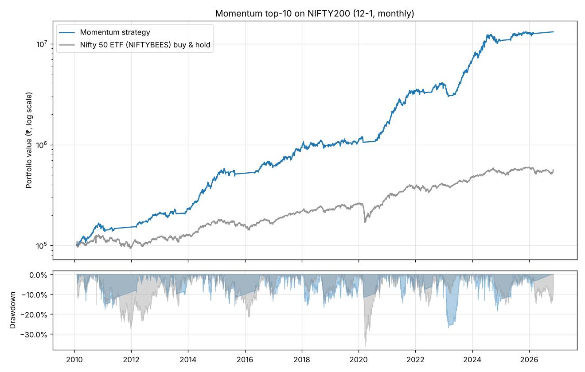

# Momentum top-10 on NIFTY200 (12-1, monthly)

Period: 2010-01-29 → 2026-11-06 (16.8 years), monthly rebalance.

| | Strategy | Nifty 50 ETF (NIFTYBEES) buy & hold |
|---|---:|---:|
| ₹99,800 became | **₹13,135,918** | ₹564,725 |
| CAGR | **+33.8%** | +10.9% |
| Worst peak-to-trough fall | **-27.0%** | -36.3% |
| Worst calendar year | -2.4% | -24.0% |
| Best calendar year | +105.2% | |
| Sharpe (6% risk-free) | 1.33 | 0.36 |
| Trades executed | 2032 | 1 |
| Friction paid (STT, fees, slippage) | ₹581,113 | ~0 |
| Months fully in cash (market filter) | 52 / 202 | 0 |

## Year by year

| Year | Strategy | Nifty 50 ETF (NIFTYBEES) |
|---|---:|---:|
| 2011 | -2.4% | -24.0% |
| 2012 | +35.2% | +27.4% |
| 2013 | +12.6% | +6.5% |
| 2014 | +100.7% | +31.6% |
| 2015 | +12.0% | -4.3% |
| 2016 | +18.1% | +4.0% |
| 2017 | +52.6% | +29.9% |
| 2018 | +6.8% | +4.8% |
| 2019 | +7.8% | +13.6% |
| 2020 | +54.2% | +15.4% |
| 2021 | +105.2% | +26.0% |
| 2022 | +15.9% | +5.5% |
| 2023 | +72.6% | +21.0% |
| 2024 | +57.9% | +10.4% |
| 2025 | +20.2% | +11.7% |
| 2026 | +1.3% | -5.0% |

## Read this before you believe it

- **Survivorship bias is large here.** The universe is *today's* index members, i.e. the companies that already won. Stocks that collapsed and were dropped from the index are invisible to this test, and a momentum strategy would have bought some of them on the way up. Published studies of Indian momentum on bias-free data land around 15-20% CAGR after costs. **Treat anything above that in the table as bias, not edge.** The *shape* (lower drawdown than the index, cash during crashes) is the trustworthy part; the headline CAGR is not.
- **Taxes are not included.** Monthly churn means most gains are short-term capital gains (20%). Nifty buy-and-hold pays long-term rates (12.5%) only when sold.
- **Fractional shares are assumed.** With a small account some high-priced stocks cannot be bought at the target weight; see `holdings.csv`.
- **The worst drawdown is the number that matters.** Ask yourself honestly whether you would have kept following the rules while down that much.

